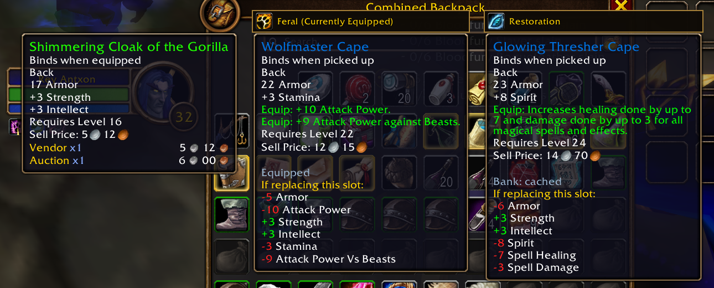
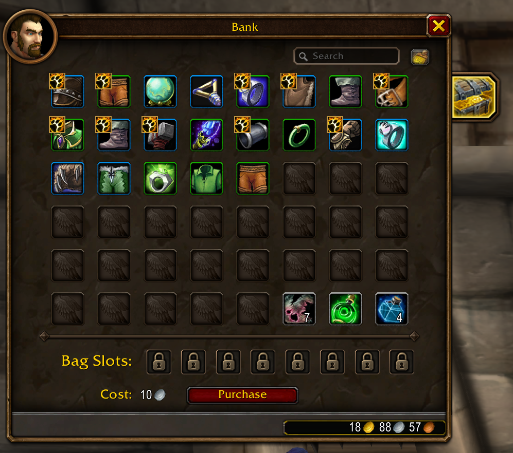
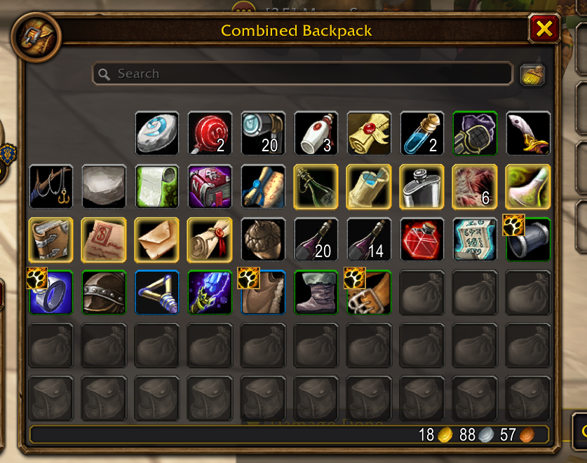

# GearSetTools for WoW Forever

Find your set gear at a glance, and compare new loot with every saved equipment set.

**Version:** 0.2.2 beta · **Client:** WoW Forever 1.60.1 · **Interface:** 16001

## Features

Marks items belonging to Blizzard equipment sets with their set icon in bags
and the bank. Hold the normal comparison modifier (usually Shift), or enable
Always Compare Items, to show full comparison tooltips for current equipment
and every saved set. Chat item-link tooltips are supported too.

The hovered item's original tooltip is first in the comparison group, followed
by current equipment and saved sets. Empty and ignored slots are omitted.
If a set uses the same item as your equipped slot, the two comparisons merge
into one, for example **Feral (Currently Equipped)**, with the set's icon.
Each comparison has a set header and the stat changes for the hovered item.
Rings and trinkets show both populated alternatives. A two-handed weapon compares against
both saved hand items together; its off-hand card is labelled accordingly.
Other weapons compare the indicated slot only; an assumed off-hand partner is
never added. Tooltips are arranged within the screen and paged if necessary.
Tap Alt while comparison is active to go to the next page.
The hovered item remains first on every page.

## Installation and first use

1. Download the release ZIP and extract the `GearSetTools` folder into
   `World of Warcraft/_forever_/Interface/AddOns/`.
2. Enable GearSetTools in the character selection AddOns menu.
3. Use the game's built-in Equipment Manager to save your sets.
4. Open your bank once to populate the cache.
5. Hold Shift over an equippable item in bags, loot, the auction house, or an
   item-link tooltip to compare it with your sets. Always Compare Items works too.

No other addons are required. Existing Blizzard equipment sets are used directly.

## Screenshots

### Compare against equipped and banked set items



### Equipment-set badges in the bank



### Equipment-set badges in bags



## Bank cache and item variants

Bank scans save complete item links, including random variants and enchants,
separately for each character. The cache persists on normal
logout or `/reload`. Snapshots are separate for each character. Unavailable
bank tabs do not erase previously scanned tabs; readable tabs replace their
own snapshots, including slots that have become empty.

Equipment-set item locations resolve full links. Forever can report banked set
members as location `-1`; in that case, the addon uses the cached full link when
there is one unambiguous variant among known bank items and accessible gear.
No base item-ID link is substituted for an unknown variant. Cached data is labelled
in comparison tooltips. If the exact item cannot be resolved, the comparison
asks you to open the bank. Deleted sets are removed from the set cache.

## Commands

- `/gst debug`: marker and cache diagnostics.
- `/gst cache`: refresh accessible cache data and print cache counts.
- `/gst next`: next comparison page.
- `/gst hover`: inspect the frame under the cursor after three seconds.
- `/gst`: refresh bag/bank markers.

## Limitations

- Standard Blizzard bags and bank are supported. Third-party bag UI support is not claimed.
- Each marked item shows the icon of its first saved set.
- Bank data reflects the last visit; open the bank again after changing its contents.
- Ambiguous same-ID item variants cannot be resolved from a missing set location alone.
- Weapon comparisons indicate whether they replace one slot or both hands.
  They do not select an assumed weapon partner from your bags.

## Development

```sh
python -m pip install -r tests/requirements.txt
python tests/test_comparison.py
python tools/package.py
```

The packaging script writes `dist/GearSetTools-0.2.2.zip`, containing only the
installable addon and its documentation, with a top-level `GearSetTools` folder.

Offline regression tests in `tests/test_comparison.py` use Lupa's Lua 5.1
runtime with WoW API stubs. They cover bank variants, persisted snapshots,
set changes, slot alternatives, native and fallback deltas, two-handed
replacement, tooltip visibility, pagination, and screen bounds. Native tooltip
appearance and compatibility with future Forever builds should be verified in game.

## License

MIT. See [LICENSE](LICENSE).
